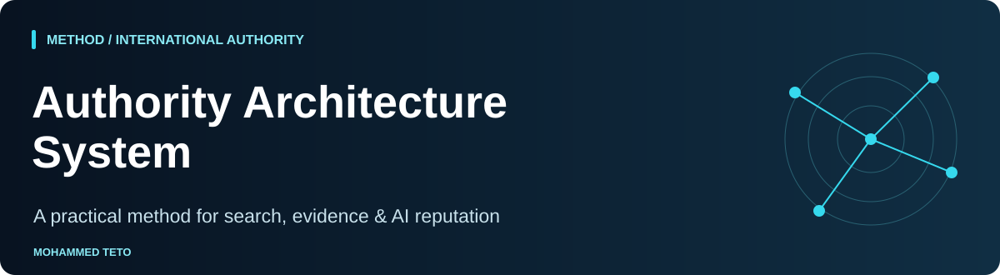

<p align="center"></p>

# Authority Architecture System

[](https://github.com/mhdteto/authority-architecture-system/actions/workflows/validate.yml)
[](https://github.com/mhdteto/authority-architecture-system/actions/workflows/connected-demo.yml)


**A public operational companion to Mohammed Teto's method for leaders and organizations.**

Connect a clear identity, substantiated claims and credible sources with the way an entity is found and described in web search and AI answers. This repository provides working templates and decision rules for that process.

[Method on MohammedTeto.com](https://mohammedteto.com/method/) · [Start with the example](examples/fictional-engagement.md) · [Templates](templates/) · [Limitations](docs/limitations.md)

<!-- shared-nav -->
<p>
  <a href="https://mohammedteto.com"></a>
  <a href="https://mohammedteto.com/method/"></a>
  <a href="https://mohammedteto.com/research/"></a>
</p>

<!-- suite-navigation -->
## Start here: this repository in the workflow

**Your task:** Start with the six-layer method.

[Method →](https://github.com/mhdteto/authority-architecture-system) · [Audit →](https://github.com/mhdteto/search-ai-discoverability-checker) · [Structure →](https://github.com/mhdteto/entity-structured-data-kit) · [Measure →](https://github.com/mhdteto/ai-citation-tracker)

**Next step:** [executive-authority-playbook](https://github.com/mhdteto/executive-authority-playbook) — Adapt the plan to a leader; then use the technical tools below.

**Try it:** [complete fictional workflow](https://github.com/mhdteto/authority-architecture-system/tree/main/examples/fictional-workflow). All scenario records and engine answers are invented; generated reports are real CLI output.

**Python CI:** 3.12. The badge links to the real workflow; it describes automated checks, not ranking, factual accuracy or AI visibility.
[Map of all eight resources](https://github.com/mhdteto/authority-architecture-system/blob/main/docs/tool-map.md) · [Open an issue](https://github.com/mhdteto/authority-architecture-system/issues/new/choose)
<!-- /suite-navigation -->

## Start here

| Your task | Open |
| :--- | :--- |
| Understand the six layers | [Operating guide](docs/operating-guide.md) |
| Establish a reproducible baseline | [Measurement protocol](docs/measurement-protocol.md) |
| Adapt the work internationally | [Markets and languages](docs/international-adaptation.md) |
| Separate claims from proof | [Evidence policy](docs/evidence-policy.md) |
| Plan an engagement | [Scope brief](templates/scope-brief.md) |
| Follow a complete fictional example | [Worked example](examples/fictional-engagement.md) |

## Six layers, six operational decisions

| Layer | Decision to make | Tangible output |
| :--- | :--- | :--- |
| 1. Perception Intelligence | What is currently observable, under which conditions? | Dated baseline and source inventory |
| 2. Narrative Positioning | Which descriptions can the record support? | Reference narrative and claim register |
| 3. Entity Foundation | Which identity is authoritative, and where does it diverge? | Canonical identity record and correction list |
| 4. Evidence and Source Authority | Which claims have relevant corroboration? | Claim-to-source evidence map |
| 5. AI Search Optimization | What prevents useful material from being found or understood? | Prioritized technical and editorial backlog |
| 6. Monitoring and Governance | Who updates the record when facts or responses change? | Review cadence, owners and change log |

The sequence supports diagnosis before implementation. Several layers may run together once their inputs are established. See the [operating guide](docs/operating-guide.md) for entry criteria and review gates.

## Use the companion tools

- [Entity Consistency Auditor](https://github.com/mhdteto/entity-consistency-auditor): compare supplied profile observations with an approved identity reference.
- [Authority Evidence Mapper](https://github.com/mhdteto/authority-evidence-mapper): connect claims to supplied evidence and expose review gaps.
- [Existing AI Visibility Audit Kit](https://github.com/mhdteto/ai-visibility-audit-kit): practical audit worksheets and prompts.
- [Existing GEO Prompt Audit Dashboard](https://github.com/mhdteto/geo-prompt-audit-dashboard): explore recorded prompt-audit data.

These resources have distinct roles. Neither a consistent profile nor a completed evidence spreadsheet establishes that a claim is true or that an AI engine will cite it.

## What is included

Operating guidance, measurement definitions, international adaptation rules, evidence review rules, reusable templates and a fully labeled fictional engagement. No client records, measured market benchmark or AI-engine observations are supplied as real results.

## Validation

No installation is needed to read the materials. To check the repository's local links and template structure, run:

```bash
python3 tools/validate.py
```

## Practice and authorship

Created by **Mohammed Teto — AI Reputation & Authority Strategist**, serving leaders and organizations internationally. [For leaders](https://mohammedteto.com/leaders/) · [For organizations](https://mohammedteto.com/organizations/) · [Research principles](https://mohammedteto.com/research/).

The website explains the advisory practice; this repository provides reusable public materials. No affiliation with or endorsement by any search engine or AI provider is implied.

## License and contribution

Documentation, templates and original artwork: [CC BY 4.0](LICENSE.md), with attribution to Mohammed Teto and a link to this repository. The repository validation script is [MIT licensed](LICENSE-CODE). [Contributions](CONTRIBUTING.md) should include sources and preserve the distinction between observed, inferred, proposed and unknown.
