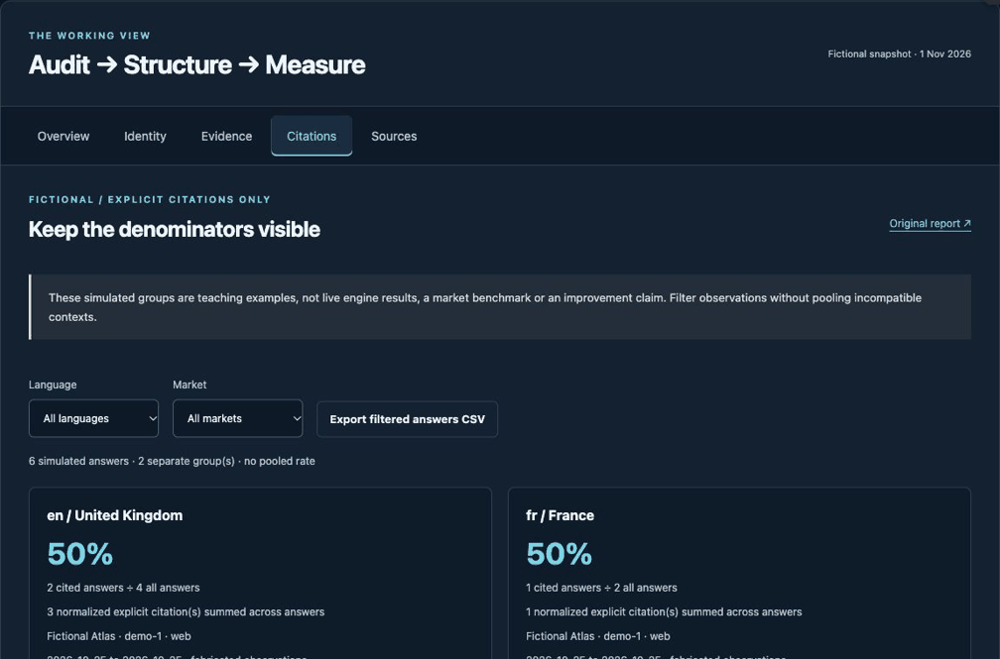

# Explorer walkthrough — actual browser capture

Recorded on 3 November 2026 from the published [Authority Explorer](https://mhdteto.github.io/authority-architecture-system/#citations). This is the real interface with fictional teaching observations. No AI engine was queried.

The short GIF plays once (about 11 seconds). Reload to replay. For a still view, open the [static screenshot](../.github/readme-assets/explorer-static.png). Captures are cropped to the working panel and resized; no values, states or interface elements are fabricated.

## Text alternative and exact sequence

1. Open **Citations** with all languages and markets: six simulated answers, two separate groups, no pooled rate. English/UK has 2 cited answers out of 4; French/France has 1 out of 2.
2. Choose **French** and **France**: two simulated answers remain; the group reads 1 cited answer divided by 2 all answers, 50%, with one normalized explicit citation.
3. Click **Export filtered answers CSV**. The browser downloads a file. The captured button is focused; the interface does not display a fabricated success toast.
4. The [actual downloaded CSV](../examples/explorer-export/fictional-citation-observations.csv) contains exactly `fr-1` and `fr-2`, both language `fr` and market `France`. It contains no UK rows. This exported sample is fictional and is supplied as a teaching artifact, not real market evidence.

Read each denominator and context before interpreting a fraction. The two invented 50% rates do not establish actual AI visibility, market equivalence or improvement.
